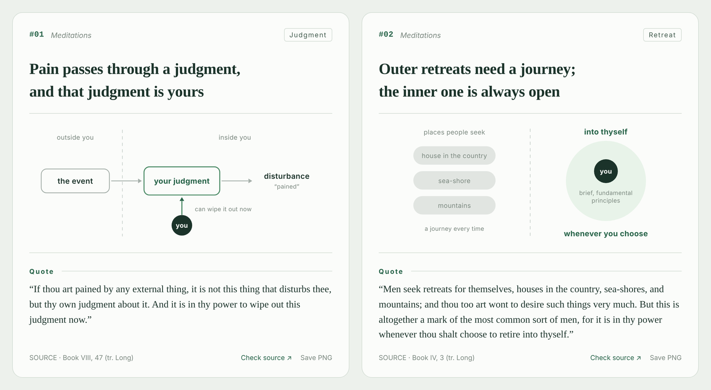

# NoteGlyph

**Turn the ideas in a book or paper into minimal, source-grounded mechanism cards.**

[Live demo](https://guoshuqi1212.github.io/noteglyph/) · [中文](README.md) · [Install](#install)



NoteGlyph is an Agent Skill. Give a book, paper or excerpt to your agent (Claude Code, Codex, Cursor and others) and it will:

1. Check the source, list the claims chapter by chapter, and let the content decide how many cards to make: every core claim gets a card, and the deck covers about 80% of the key points. Claims with no drawable mechanism (contrast, cause, threshold, feedback…) stay in a text outline.
2. Make one card per claim: a two-line conclusion, one mechanism diagram, a labelled quotation and its source.
3. Deliver a standalone HTML page and a JSON file. The next session continues the numbering from that JSON, and any card can be saved as a PNG.

## What makes it different

- **Shapes have fixed meanings.** Vertical dashes mean contrast, horizontal dashes mean a threshold, a tinted box marks a foundation, the dark circle is “you”, a dotted green line is exploration. A symbol means the same thing on every card, so a deck gets faster to read. Gray-versus-green value contrasts appear only when the source itself makes that judgment. See the [visual grammar](references/design-system.md) (Chinese).
- **Sources are required.** Every quotation is labelled Quote, Quote / Translation, Paraphrase or Editorial. Cards without a source fail validation, and cross-chapter synthesis must carry an editor’s note. See the [source policy](references/source-policy.md) (Chinese).
- **The book sets the card count.** There is no fixed number. The agent lists candidate claims from every chapter, ranks them, cards every core claim, covers about 80% of the key points, and tells you what is still missing.
- **Decks keep growing.** Numbering runs through the whole book, and the outline marks each item as carded or not yet carded.

## Demos

Both demos use public-domain texts, with every quotation checked against the source.

| | Content | View | Data |
|---|---|---|---|
| English | *Meditations*, tr. George Long (1862): 6 outline items, 4 cards | [open](https://guoshuqi1212.github.io/noteglyph/meditations.html) | [meditations.json](examples/meditations.json) |
| 中文 | *The Analects*: learning, teaching and action, 8 items, 5 cards | [open](https://guoshuqi1212.github.io/noteglyph/lunyu.html) | [lunyu.json](examples/lunyu.json) |

<table>
  <tr>
    <td width="34%" valign="top"><br><sub>Phone</sub></td>
    <td valign="top"><br><sub>Dark mode</sub><br><br><br><sub>Single-card PNG export</sub></td>
  </tr>
</table>

## Install

```bash
npx skills add guoshuqi1212/noteglyph
```

This installs into the current project; add `-g` for a global install. You can also paste the prompt in [INSTALL_WITH_AGENT.md](INSTALL_WITH_AGENT.md) into your agent, which will then install the skill and run the tests to verify it.

Then ask:

> Use NoteGlyph to turn this book into visual notes in English. Check the source first, let the content decide how many cards to make, card every core claim so the deck covers about 80% of the book, and put the rest in the outline.

You can still ask for a fixed number, such as “make 12 cards”. If that is too few for the core claims, the agent will say which ones are left out.

Finding and checking the source depends on what your agent can read. The renderer itself works offline and does not parse PDFs.

## Renderer only

Python 3.9+, standard library only.

```bash
python scripts/render.py examples/meditations.json --check-only
python scripts/render.py examples/meditations.json --out meditations.html
```

Set `book.lang` to `"en"` for English UI text, English topic labels (one or two words) and English quotation labels. `book.kind` can be `book`, `paper` or `article`. Fields are documented in [data-format.md](references/data-format.md) (Chinese, with English tables).

## Layout

```text
SKILL.md                       rules the agent follows
references/                    visual grammar · source policy · data format
assets/gallery-template.html   page template (styles, interaction, PNG export)
scripts/render.py              validator + renderer, stdlib only
examples/                      starter · lunyu (zh) · meditations (en)
docs/                          GitHub Pages: rendered demos and screenshots
tests/                         unit tests
```

## License

Code, skill instructions, templates and example data are [MIT](LICENSE) licensed. The example texts are in the public domain: *The Analects*, and Marcus Aurelius’s *Meditations* in George Long’s 1862 translation. Other books and papers you process with NoteGlyph remain under their own copyright; MIT does not cover them, so share only short quotations.
