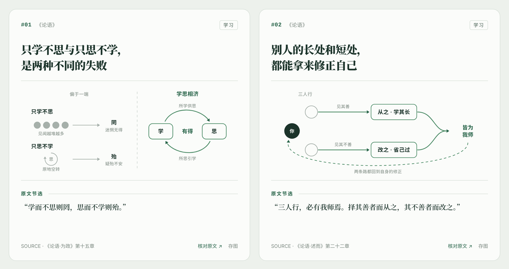
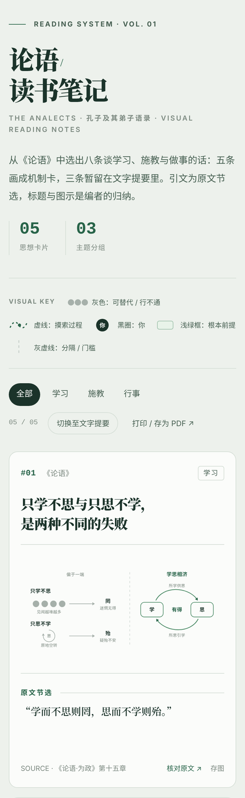
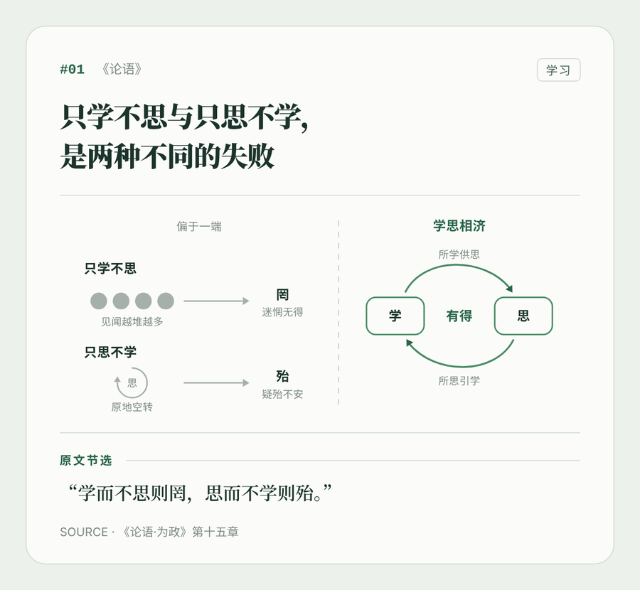

# NoteGlyph · 图见

**把书和论文里的观点，画成有出处、语义统一的极简机制卡片。**

[在线示例](https://guoshuqi1212.github.io/noteglyph/) · [English](README.en.md) · [安装](#安装)



NoteGlyph 是一个 Agent Skill。把一本书、一篇论文或一段摘录交给你的 Agent（Claude Code、Codex、Cursor 等），它会：

1. 先核对原文，挑出能画出机制的观点（对比、因果、门槛、反馈……），说不清机制的留在文字提要里；
2. 每个观点做成一张卡：两行结论式标题、一张机制图、标明类型的引文和出处；
3. 交付一个单文件 HTML 和一份 JSON。下次从最后的编号接着做，每张卡都能一键存成 PNG。

## 和普通知识卡片的区别

- **图形有固定含义。** 竖虚线是对比，横虚线是门槛，浅绿底框是根本前提，墨色圆圈是“你”，绿色虚线加点是摸索。同一个符号在每张卡里意思都一样，读得越多越快。灰绿的价值对比只在原文本身有价值判断时才用。详见 [视觉语法](references/design-system.md)。
- **出处是硬要求。** 每段引文都标明是原文节选、原文加翻译、意译还是编辑提炼；没有出处的卡片过不了校验；跨章节综合或借用注释必须写编辑注。详见 [出处规则](references/source-policy.md)。
- **卡组能一直续写。** 全书连续编号，文字提要分“已制卡 / 待制卡”，JSON 就是工作底稿。

## 示例

两份示例都用公版原文，引文逐句核对过。

| | 内容 | 在线查看 | 数据 |
|---|---|---|---|
| 中文 | 《论语》：学习、施教与做事，8 条提要、5 张卡 | [打开](https://guoshuqi1212.github.io/noteglyph/lunyu.html) | [lunyu.json](examples/lunyu.json) |
| English | *Meditations*, tr. George Long (1862)：6 条提要、4 张卡 | [打开](https://guoshuqi1212.github.io/noteglyph/meditations.html) | [meditations.json](examples/meditations.json) |

<table>
  <tr>
    <td width="34%" valign="top"><br><sub>手机</sub></td>
    <td valign="top"><br><sub>深色模式</sub><br><br><br><sub>单卡导出 PNG</sub></td>
  </tr>
</table>

## 安装

```bash
npx skills add guoshuqi1212/noteglyph
```

默认装到当前项目，加 `-g` 装到全局。也可以把 [INSTALL_WITH_AGENT.md](INSTALL_WITH_AGENT.md) 里的一段话发给 Agent，让它代为安装并跑测试验证。

装好后这样用：

> 用 NoteGlyph 把这本书做成视觉笔记：先核对原文，挑 8 个最能画出机制的观点做成卡片，其余放进文字提要。

查找和核对原文依赖 Agent 能读到的材料；渲染器本身不联网，也不读 PDF。

## 单独使用渲染器

需要 Python 3.9+，只用标准库，离线可用。

```bash
python scripts/render.py examples/lunyu.json --check-only          # 只校验
python scripts/render.py examples/lunyu.json --out lunyu.html      # 生成网页
```

把 `book.lang` 设为 `"zh"` 或 `"en"`，界面文案、主题标签规则和引用类型标签会随之切换；`book.kind` 可设为 `book`、`paper` 或 `article`。字段说明见 [数据格式](references/data-format.md)。

## 目录

```text
SKILL.md                       Agent 读的工作规则
references/                    视觉语法 · 出处规则 · 数据格式
assets/gallery-template.html   页面模板（样式、交互、单卡导出）
scripts/render.py              校验 + 渲染，纯标准库
examples/                      starter（结构模板）· lunyu · meditations
docs/                          GitHub Pages：示例网页与截图
tests/                         单元测试
```

## 参与

欢迎提 issue 和 PR，先看 [CONTRIBUTING.md](CONTRIBUTING.md)。更新记录见 [CHANGELOG.md](CHANGELOG.md)。

## 许可

代码、Skill 说明、模板和示例数据采用 [MIT](LICENSE) 许可。示例原文均为公版：《论语》；Marcus Aurelius, *Meditations*, George Long 1862 年英译本。用 NoteGlyph 处理的其他书籍和论文，版权仍归原权利人，MIT 不覆盖这些内容；公开分享时请只用短引文。
